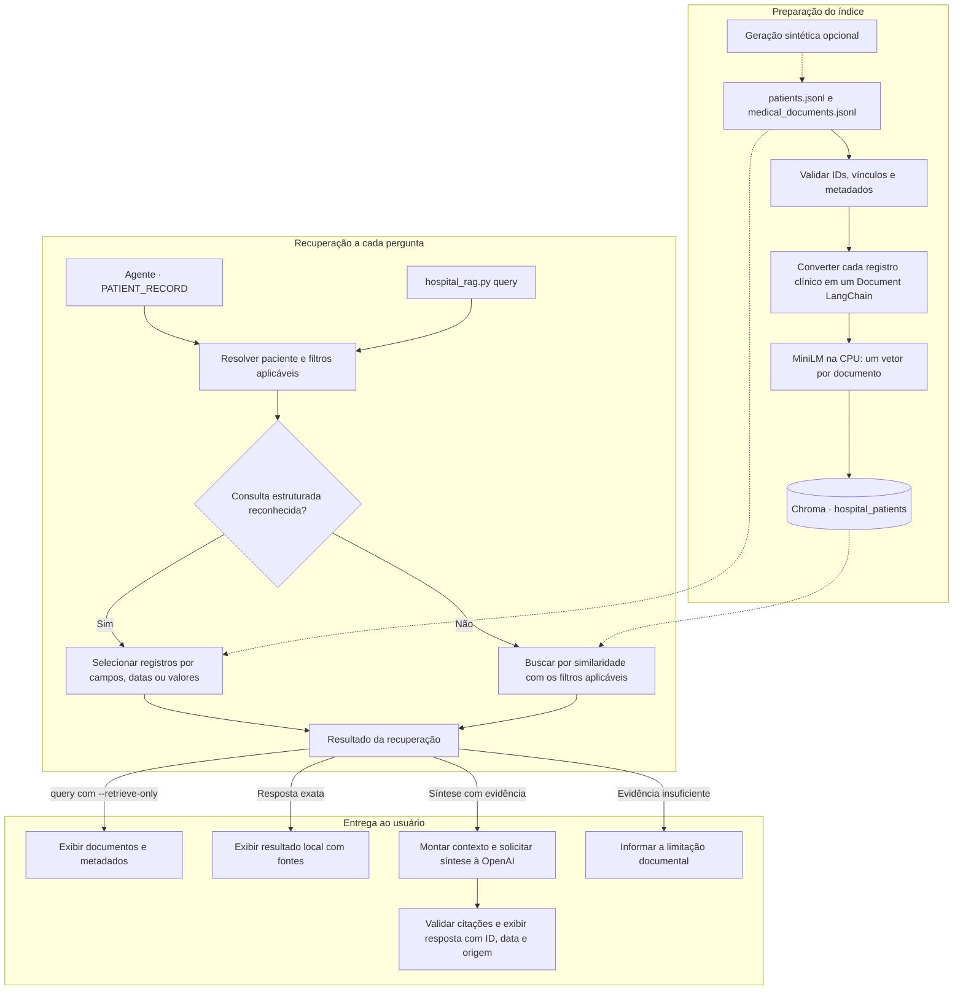

# RAG hospitalar sintético

O serviço RAG recupera cadastros e documentos clínicos artificiais por paciente, tipo e conteúdo. Há duas formas de usá-lo. O agente conversacional mantém o paciente ativo entre turnos. O utilitário `scripts/hospital_rag.py` permite inspecionar o índice e fazer uma consulta independente, inclusive sem gerar texto. [Guia do agente](README.md) · [Base sintética e relatórios](README_RAG_DATA.md)

## Do prontuário à resposta

Os arquivos JSONL já acompanham o clone. Na primeira ingestão, os 1.787 documentos da base geram **1.787 vetores** na coleção `hospital_patients`. Durante a consulta, os JSONL também permitem responder a pedidos como “Quais foram os últimos três exames?” ordenando os registros do paciente por data.



Perguntas médicas gerais seguem pela rota `GENERAL_MEDICAL` diretamente para o Llama local.

## Agente local

Para instalar o ambiente, configurar as credenciais e iniciar a conversa, siga o [README principal](README.md#instalação). No grafo, a rota `PATIENT_RECORD` resolve a identidade antes de recuperar registros. A rota `GENERAL_MEDICAL` usa o Llama local. O comando `query` do utilitário acessa o serviço RAG diretamente, sem passar pelo roteamento e pela memória do agente.

## Ingestão e índice

Na raiz do clone, com a `.venv` ativa, execute:

```powershell
python scripts/hospital_rag.py ingest
python scripts/hospital_rag.py stats
```

A ingestão valida os JSONL versionados, converte cada documento em um `Document` LangChain e calcula um vetor normalizado com `sentence-transformers/paraphrase-multilingual-MiniLM-L12-v2`, na CPU. A primeira execução pode baixar o modelo. Cada `document_id` identifica um vetor na coleção `hospital_patients`, persistida em `database/chroma/`. Para a base distribuída, espere **1.787 vetores**.

Repetir a ingestão da mesma base ignora documentos inalterados e atualiza os alterados. Para uma nova população, use um diretório de persistência novo. Se trocar o modelo de embeddings ou a estratégia de indexação, use uma nova coleção. Os caminhos, o modelo e os limites de recuperação ficam em [src/config.py](src/config.py).

## Consultas estruturadas e busca vetorial

O resolvedor identifica o paciente por prontuário, nome normalizado ou trecho de nome inequívoco. O recuperador tenta as operações estruturadas reconhecidas, como listar exames, selecionar os três mais recentes e localizar o resultado de uma data. Elas consultam os JSONL, o que permite ordenar datas e consultar todos os registros pertinentes. Na busca semântica, o Chroma devolve os documentos mais próximos da pergunta com os filtros aplicáveis. O valor padrão de K é 5.

Para inspecionar os documentos e metadados recuperados sem chamar a OpenAI:

```powershell
python scripts/hospital_rag.py query "Quais sintomas foram relatados?" --patient-id PCT-000001 --document-type anamnese --retrieve-only
```

Para consultar o serviço com resposta e fontes:

```powershell
python scripts/hospital_rag.py query "Quais os últimos 3 exames?" --patient-id PCT-000086
python scripts/hospital_rag.py query "Quais sintomas foram relatados?" --patient-name "Emanuel Cunha Cordeiro" --document-type anamnese
```

Uma consulta com resposta exata usa o resultado local. Quando a resposta exige geração, o serviço monta o contexto, chama a OpenAI e confere se os IDs citados pertencem aos documentos enviados. O método de serviço devolve `sources` e `retrieved_documents`. O comando exibe a resposta e as fontes. Para explorar ingestão, estatísticas e consultas em um menu, execute `python scripts/hospital_rag.py menu`. [Serviço de consulta](src/rag/rag_service.py)

## Síntese e citações no agente

Na conversa, a consulta exata devolve o fato documentado. Para interpretar ou sintetizar registros, o agente mascara a pergunta e as evidências, atribui identificadores temporários aos documentos e pede à OpenAI uma resposta estruturada que atribua os achados às fontes. A aplicação valida as referências devolvidas e recupera localmente o ID original, a data e a origem de cada fonte usada. O código do prontuário consultado pode aparecer na apresentação. [Síntese documental](src/agent/records.py)

Quando os registros são insuficientes, a CLI sinaliza ausência de evidência. Uma falha no provedor, no formato da síntese ou na validação das citações produz uma mensagem de síntese indisponível. O modelo OpenAI configurado precisa aceitar a saída estruturada usada pelo agente. As credenciais e os passos de diagnóstico estão no [guia de execução](README.md#diagnóstico-e-testes).

O utilitário técnico também admite buscas sem paciente e algumas operações sobre toda a base, como contagem de pacientes ou maior valor documentado de um exame. O agente conversacional delimita as consultas de prontuário ao paciente identificado. Esse filtro é demonstrativo. Um sistema com dados reais exigiria autorização por usuário e isolamento de acesso.

## Testes e validação registrada

Execute `python -m pytest -q` para verificar recuperação, isolamento, respostas estruturadas, citações e idempotência com dependências simuladas. Para incluir o teste opcional de dimensão e norma do MiniLM real, disponibilize o modelo e defina `$env:TEST_REAL_MINILM = '1'` antes da suíte.

Em **19/11/2026**, a validação histórica do módulo registrou 42 testes aprovados, incluindo o MiniLM em CPU. A primeira ingestão inseriu 1.787 documentos e a segunda ignorou os 1.787 registros inalterados. A consulta por paciente e tipo retornou apenas as duas anamneses de `PCT-000001`. O teste do cliente OpenAI nessa execução utilizou transporte HTTP simulado.
