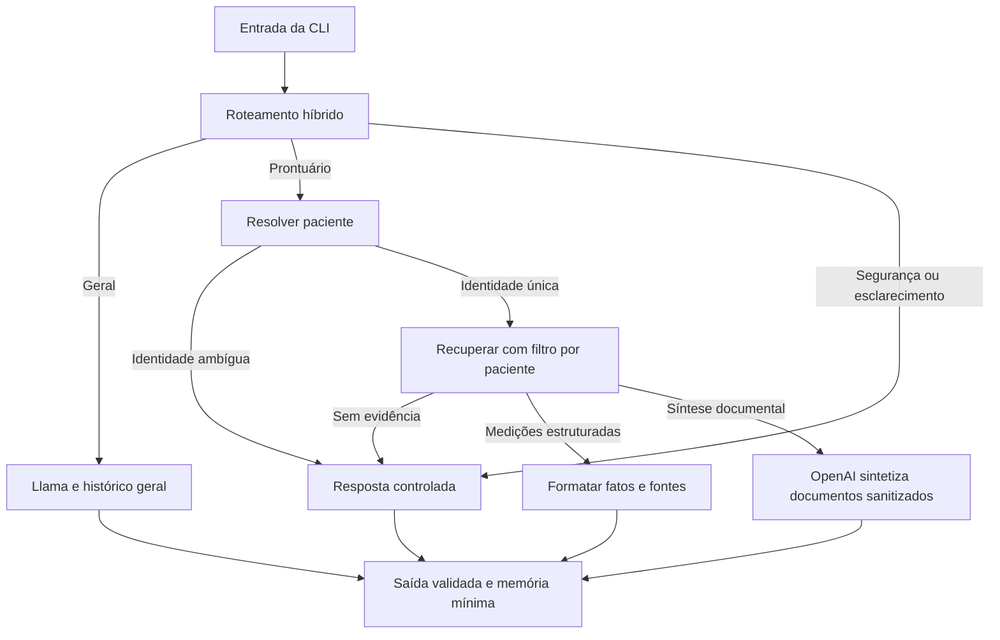

# Agente conversacional local do TCv2

## A. Diagnóstico

O TCv2 tem dois pipelines de dados. O primeiro prepara MedQuAD, PubMedQA e exemplos hospitalares sintéticos para o ajuste supervisionado. O segundo fornece prontuários sintéticos ao RAG. O resumo do primeiro registra 26.784 exemplos curados, 24.105 de treino, 2.679 de validação e 1.000 de avaliação PubMedQA. O notebook configura QLoRA para Llama 3.1 8B Instruct, sequência de 2.048 tokens e 300 passos. [Orquestração dos dados](../scripts/Process_dataset.py) · [Notebook](../notebooks/colab_finetuning.ipynb)

O segundo pipeline tem 200 pacientes e 1.787 documentos, com 6 a 12 documentos por paciente. São 200 cadastros, 484 anamneses, 484 painéis laboratoriais, 319 laudos de imagem e 300 evoluções. Os painéis fornecem analito, valor, unidade e referência em `metadata.results`. Os cadastros incluem nome, cidade e nascimento. A inspeção original não identificou campos específicos para CPF, RG, CEP, endereço, telefone ou e-mail. Esses dados ainda podem aparecer em texto livre ou em futuras bases. [Relatório da base sintética](../data/rag_data/validation_report.json)

| Componente reutilizado | Diagnóstico de partida |
|---|---|
| `load_medical_model()` | Descobre o modelo-base pelo adaptador PEFT. O cache indicava base pré-quantizada NF4 com dupla quantização e cálculo BF16. A configuração FP16 criada no carregador anterior não era passada à carga. Na RTX 2070 Max-Q, a carga atual usa cálculo FP16. |
| `generate_response()` | A inferência experimental já aplicava o template do Llama, selecionava o dispositivo dos embeddings, encerrava por EOS/EOT e decodificava a continuação. A extração para `LocalInference` permite passar mensagens e manter a mesma implementação de geração. |
| `HospitalDocumentLoader`, `EmbeddingService`, `ChromaService` | Validação dos JSONL, embeddings MiniLM multilíngues na CPU, ingestão idempotente e busca da coleção `hospital_patients` em `database/chroma`. A CLI adiciona abertura de coleção existente, com falha controlada se estiver ausente ou incompatível. |
| `PatientResolver`, `RetrieverService`, `exact_query()` | Resolução por ID e nome, desambiguação, filtros e consultas estruturadas. O agente reaproveita esses componentes com exigência de paciente resolvido e confirmação do escopo após a recuperação. |
| `ContextBuilder` e geração RAG | O caminho anterior aceitava gerador injetável, deduplicava documentos e validava IDs de fontes. As consultas exatas podiam retornar texto integral. O agente reutiliza o construtor de contexto, verifica as fontes efetivamente apresentadas e aplica redução de dados também à saída exata. |

O ambiente de referência tem Python 3.12.10, Torch 2.10.0+cu128, Transformers 5.22.2, PEFT 0.21.3, bitsandbytes 0.50.2, Accelerate 1.16.0, LangChain Core 1.8.0, ChromaDB 1.5.9 e Sentence Transformers 6.3.0. LangGraph 1.2.24 foi instalado e fixado no manifesto. [Dependências](../requirements.txt)

## B. Arquitetura



- `StateGraph` orquestra nós síncronos. O roteamento combina regras para casos inequívocos e classificação semântica com o mesmo Llama nos demais. O classificador gera um número entre quatro rótulos permitidos. Rótulos inválidos levam a esclarecimento. A resolução de identidade usa os mecanismos determinísticos do cadastro.
- A recuperação exige identidade resolvida. A menção explícita prevalece sobre a memória. Quando um pedido documental omite a identidade, o agente usa o paciente ativo, mesmo após um turno médico geral. Uma tentativa de troca com identidade desconhecida, ambígua ou conflitante suspende a seleção. Todo resultado é conferido novamente antes de entrar no contexto.
- Para medições suportadas, o agente consulta o JSONL integral no escopo do paciente, seleciona o analito e ordena por data. Empates mantêm as fontes. A comparação entre datas exige unidades iguais e ao menos duas medições em datas distintas. O valor da diferença é calculado deterministicamente com `Decimal`.
- A síntese usa documentos sanitizados e aliases temporários por turno. A OpenAI devolve itens com texto e uma ou mais fontes. O agente verifica se cada alias foi enviado e publica ID, data e origem reais. Listas de exames e consultas factuais exatas usam os dados estruturados. Uma pergunta mista pode acrescentar uma explicação geral produzida pelo Llama em seção própria.
- `LocalInference` carrega uma instância por CLI. Os perfis compartilham os pesos e o tokenizer. Uma trava serializa a geração. `LocalChat` adapta mensagens de texto ao contrato `invoke()`.
- O `InMemorySaver` guarda somente estado conversacional minimizado. O estado contém identificador interno quando há paciente ativo, tópico ou analito, pedido pendente minimizado, idioma, última rota e até três turnos gerais. Dados brutos do turno e resultados do prontuário circulam no contexto transitório. A compactação periódica remove snapshots antigos. `/limpar` e `/nova` apagam a conversa corrente.

### Proteção de dados

O agente usa os identificadores apenas nas etapas que precisam deles. Verifica a entrada para pedidos de divulgação, instruções maliciosas, pedidos clínicos definitivos e sinais explícitos de emergência. O filtro determinístico usa campos permitidos, rótulos e padrões de identificadores brasileiros, além de nomes e municípios presentes no cadastro. As regras diferenciam datas de nascimento de datas clínicas. O nome confirmado pode aparecer na CLI com as referências documentais do mesmo paciente. Prompts, memória e logs técnicos recebem apenas os dados pertinentes à sua função. Traces externos do grafo ficam desativados.

Os filtros são proporcionais a um protótipo sobre dados sintéticos. Regex em texto livre tem cobertura limitada. O uso com dados reais exigiria autorização por paciente e organização derivada da identidade autenticada, além de auditoria, retenção e proteção operacional dos dados.

## C. Viabilidade e escolhas

Uma instância com batch 1 evita duplicar os pesos e a memória de geração. A configuração em cache indica 32 camadas, 8 cabeças KV e dimensão de cabeça 128. Com dois bytes por elemento, o cache integral de K e V custa aproximadamente 128 KiB por token, ou 256 MiB em 2.048 tokens. O pico real inclui buffers, ativações e memória reservada pelo alocador. [Cache do Transformers](https://huggingface.co/docs/transformers/kv_cache)

O perfil local usa até 2.048 tokens totais. A classificação usa um token e o limite de resposta geral fica em `AGENT_ANSWER_TOKENS`. O agente descarta turnos gerais antigos para respeitar esse orçamento. Em OOM durante geração local, libera blocos livres e tenta uma vez com orçamento menor. O contexto enviado à OpenAI é limitado separadamente em `src/config.py`.

O grafo explícito torna as transições e o escopo testáveis. Regras puras oferecem baixa latência, mas são menos adequadas para elipses, hipóteses e alternância de idioma. Classificação integral pelo Llama acrescenta uma geração por turno. O híbrido concentra esse custo nos casos que precisam dele. A qualidade de respostas em português e a precisão do classificador exigem avaliação própria, pois o ajuste foi predominantemente em inglês.

A geração geral e o classificador usam o modelo local. A síntese envia à OpenAI somente o contexto sintético preparado para a pergunta, com identificadores minimizados. A validação das citações verifica a proveniência. A avaliação da fidelidade clínica requer comparação do texto gerado com os registros. As medições de síntese com seleção de trecho na seção E correspondem à arquitetura anterior.

## D. Entrega incremental e testes

| Etapa | Resultado e aceite |
|---|---|
| 1. Inferência | Carregador PEFT e geração reutilizável com perfis. Confirmar CUDA, NF4, dtype efetivo e pelo menos dois turnos gerais com uma carga. |
| 2. Roteamento e memória | Grafo com quatro rotas, esclarecimento, isolamento por thread e compactação. Testar entradas bilíngues, hipóteses, pronomes, homônimos, troca de identidade e limpeza. |
| 3. RAG | Consultas estruturadas e vetoriais com escopo. Testar retorno incorreto do backend, ausência de resultados, conflito de evidências, grafia de citações, injeção em documento e identificadores em ambos os caminhos. |
| 4. CLI | Inicialização única, comandos de sessão e encerramento controlado. Usar `python -m scripts.medical_agent`. |
| 5. Avaliação | Suíte CPU com fakes, regressões do RAG, teste opcional de embeddings e benchmark CUDA com dados sintéticos. |

```powershell
& .\.venv\Scripts\python.exe -m pytest -q
$env:TEST_MEDICAL_AGENT_GPU_TURNS = '50'
& .\.venv\Scripts\python.exe -m pytest tests/test_medical_agent_gpu.py -q -s
Remove-Item Env:TEST_MEDICAL_AGENT_GPU_TURNS
```

O benchmark usa os modelos em cache, a coleção existente e `psutil` para amostrar RAM. Registra tempo de carga, p50/p95 por turno, latência e tokens por geração e pico de VRAM alocada e reservada. As rotas esperadas são verificadas em execução. Os cenários percorrem perguntas gerais, consultas exatas, referência a um paciente ativo e recuperação narrativa.

Para medir qualidade em escala, rotular perguntas variadas em PT/EN separadas dos exemplos de prompt. Comparar regras, roteamento híbrido e LLM em matriz de confusão, com recall de prontuário e falsos negativos para a rota geral. Para o RAG, comparar Recall@5, citações válidas, alegações sustentadas e abstenção na ausência de evidência. A comparação de geração usa as mesmas perguntas com o Llama ajustado com e sem evidência e, se disponível, uma execução independente do modelo-base. A avaliação crítica exige zero mistura entre pacientes e zero citações inventadas aceitas.

## E. Limites observados

O primeiro teste local carregou o Llama com 5.599 MiB alocados e cálculo FP16. Com o limite inicial de 256 tokens, duas perguntas gerais levaram aproximadamente 76 e 37 segundos, com picos de cerca de 5.748 e 5.807 MiB alocados. Houve repetição em ambas. O limite passou para 160 tokens e a saída geral passou a descartar sentenças duplicadas e referências externas geradas. Consultas exatas por creatinina e glicemia no mesmo prontuário responderam com fonte em cerca de 60 ms por turno. Esses números representam a primeira passagem local. Os resultados não estabelecem desempenho de cauda nem fidelidade clínica.

Na passagem de cinco turnos com o perfil de 160 tokens, todas as respostas esperadas foram obtidas. As consultas exatas levaram 62–70 ms e a seleção narrativa, com geração de um token, levou 0,74 s. As duas perguntas gerais levaram 46 e 52 s. A VRAM alocada atingiu 5.790 MiB.

No teste de estabilidade, os 50 turnos terminaram com sucesso, com uma carga de 17,02 s e pico de 5.790 MiB de VRAM alocada. A RAM residente amostrada teve pico de 2.255 MiB e diferença de 43 MiB entre o primeiro e o último turno. O p50 foi 0,07 s e o p95 foi 0,75 s para a distribuição do teste, que contém 48 turnos documentais e dois gerais. Os dois turnos gerais levaram cerca de 46–55 s.

Na verificação direta do classificador, o rótulo restrito resolveu a continuação geral em português. Uma referência explícita a um prontuário anterior em inglês foi classificada incorretamente pelo modelo isolado e é coberta pela regra de continuidade do grafo. A comparação de qualidade em um conjunto bilíngue amplo ainda depende de rotulagem e revisão.

A suíte final com MiniLM em CPU passou em 73 testes. O benchmark CUDA foi executado separadamente.
