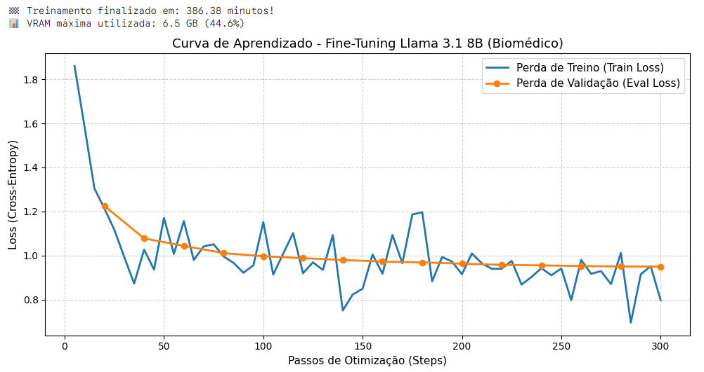
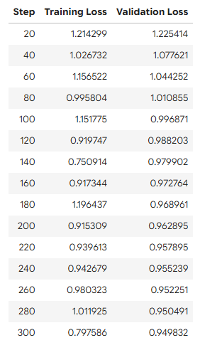
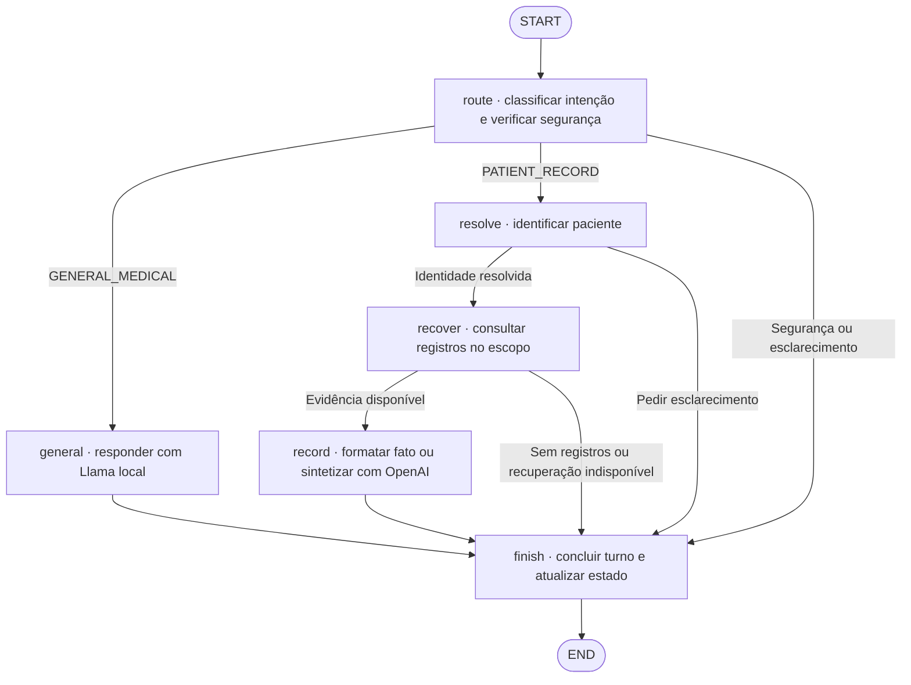

# Tech Challenge - Fase 3 - Turma 10IADT - FIAP

# Relatório técnico do assistente de informação biomédica

**FIAP · IA para Devs · Tech Challenge, Fase 3**

**Escopo da avaliação:** preparação dos dados, ajuste supervisionado do Llama, agente conversacional e recuperação de prontuários sintéticos.

## 1. Introdução e objetivo

Este projeto visa criar um agente de inteligência artificial de suporte médico para profissionais médicos.

O agente deve tirar dúvidas gerais e também responder perguntas baseadas em uma base de pacientes viva, ou seja, uma base com atualizações frequentes. Podem ser obtidos dados do paciente como histórico de anamneses, laudos e resultados de exames, com a segurança de que informações médicas não serão embaralhadas com outros pacientes. 

Ao perguntar para o agente perguntas de cunho médico, como “O que é hemoglobina glicada?”, ele espera uma explicação biomédica geral. Ao perguntar “Qual foi o último exame desta paciente?”, espera um fato de um prontuário específico, com data e origem.

O objetivo é oferecer informação acadêmica, explicitar a origem das respostas e reconhecer quando a evidência é insuficiente. O acervo hospitalar é fictício. Os resultados a seguir avaliam comportamento do software, geração de texto e fidelidade a esse acervo. Uma alegação de utilidade para assistência clínica real exigiria validação profissional e avaliação em outro contexto. [Guia de execução](../README.md)

## 2. Da preparação dos dados ao ajuste no Kaggle

### Fontes, rastreabilidade e separação

| Fonte após curadoria | Contribuição para o aprendizado | Treino | Validação |
|---|---|---:|---:|
| MedQuAD | Perguntas de saúde e respostas de fontes NIH, com origem e URL quando disponível | 14.513 | 1.609 |
| PubMedQA, partição `pqa_artificial` | Pergunta acompanhada de evidência do resumo, resposta longa, decisão quando disponível e PMID | 8.992 | 1.008 |
| Exemplos hospitalares sintéticos | FAQ de protocolos, casos, modelos de laudo, minutas e exemplos de segurança | 600 | 62 |
| **Total** | **26.784 exemplos curados** | **24.105** | **2.679** |

O carregador lê o MedQuAD e seleciona pares com pergunta e resposta. Para PubMedQA, amostra 10.000 artigos de `pqa_artificial` e monta a evidência com até 3.000 caracteres do resumo. A terceira fonte é gerada localmente por templates em inglês para cinco protocolos fictícios: sepse, dor torácica/síndrome coronariana aguda, hipoglicemia, AVC e crise hipertensiva. Os casos incluem identificadores brasileiros fictícios para exercitar o mascaramento. Os documentos de pacientes usados pelo RAG pertencem a outro acervo. [Pipeline](../scripts/Process_dataset.py) · [Gerador de exemplos](../src/synthetic_generator.py) · [Guia da base RAG](../README_RAG_DATA.md)

Antes da unificação, o gerador fornece os nomes conhecidos ao anonimizador. Uma segunda passagem aplica as regras de mascaramento ao conjunto combinado. A curadoria normaliza espaços, filtra pares que violam os limites de tamanho e remove duplicatas de pergunta e resposta. Cada linha aceita é convertida em três mensagens: instrução de sistema, pergunta e resposta de referência. A divisão aleatória de 90%/10% usa semente 42. Os JSONL são validados após a exportação, os descartes recebem motivos e o manifesto identifica a origem por linha e partição. [Anonimização](../src/anonymizer.py) · [Curadoria](../src/curation.py) · [Conversor](../src/jsonl_converter.py) · [Manifesto](../data/processed/dataset_manifest.csv)

A referência é um comportamento explicitamente ensinado. Na leitura dos JSONL desta execução, **24.101 das 24.105 respostas de treino** e **2.679 das 2.679 de validação** continham o marcador textual `Source:` ou `Fonte:` (busca sem distinção de caixa). Essa contagem mede a presença do marcador nas respostas-alvo. O prompt de sistema também pede que o modelo cite a origem, acompanhe o idioma da pergunta e distinga achados de interpretação. [Configuração do treinamento](../src/config.py)

O pipeline exporta **1.000 itens** de `pqa_labeled` para avaliação independente com decisão esperada `yes`, `no` ou `maybe`. No acervo local, nenhum dos 1.000 PMIDs de avaliação coincidiu com os 10.000 PMIDs PubMed extraídos das referências de treino e validação. O controle cobre a identidade do artigo nesse conjunto. Assuntos relacionados podem aparecer em várias fontes.

### Treinamento supervisionado

O arquivo conserva o nome de Colab, mas a execução de referência ocorreu principalmente no **Kaggle**. Os JSONL de treino e validação foram anexados ao notebook como entrada. A célula do Kaggle localiza os arquivos em `/kaggle/input` e define `/kaggle/working/lora_model` como destino do adaptador. A célula de Google Drive oferece o caminho alternativo para Colab. [Notebook executável](../notebooks/colab_finetuning.ipynb) · [Guia de reprodução](../README_finetuning.md)

O Unsloth carrega o Llama 3.1 8B Instruct em 4 bits. O QLoRA ajusta matrizes de baixo posto nas projeções da atenção e da rede de alimentação direta enquanto os pesos de base permanecem congelados. O template de chat delimita os papéis, e `train_on_responses_only` concentra o cálculo de perda nos tokens da resposta do assistente. O resultado é um adaptador carregado sobre a base indicada em sua configuração PEFT. [Adaptador oficial mparra137/llama-lora-medical-tc3-300](https://huggingface.co/mparra137/llama-lora-medical-tc3-300)

| Parâmetro | Execução de referência |
|---|---|
| Adaptador e contexto | Rank 16, alpha 16, dropout 0, sequências de até 2.048 tokens |
| Otimizador | AdamW de 8 bits, taxa configurada de 0,0002, 20 passos de aquecimento e agendamento linear |
| Lote efetivo em uma GPU | 2 exemplos por dispositivo × 4 minilotes acumulados = 8 exemplos por atualização |
| Orçamento | 300 atualizações do otimizador, cerca de 2.400 exemplos processados (aproximadamente 10% de uma passagem pelo treino) |
| Monitoramento | Perda de treino registrada a cada 5 passos, avaliação a cada 20 e checkpoint a cada 50 |

### Curva de aprendizado

| Passo | Perda de treino registrada | Perda de validação |
|---:|---:|---:|
| 20 | 1,214299 | 1,225414 |
| 100 | 1,151775 | 0,996871 |
| 200 | 0,915309 | 0,962895 |
| 300 | 0,797586 | 0,949832 |

Entre a primeira e a última avaliação, a perda de validação caiu **22,5%**. Houve melhora nas 15 medições sucessivas, com ganhos menores no final: de 200 a 300 a queda foi de 0,013063. O passo 300 atingiu o menor valor observado. O gráfico registra **386,38 minutos** e **6,5 GiB de VRAM máxima reservada**. A oscilação dos pontos de treino acompanha minilotes distintos, enquanto as avaliações usam a mesma partição.

O resultado sustenta uma melhora na previsão dos tokens de referência durante o ajuste. O primeiro ponto de validação já corresponde ao passo 20, e a série termina no orçamento escolhido de 300 passos. Para estimar ganho sobre a linha de base ou determinar o ponto ótimo, seriam necessárias medições antes do ajuste e em execuções adicionais. As figuras de perda constituem o registro quantitativo do treino disponível para este relatório.

## 3. Assistente médico e grafo de execução

A entrada é `python -m scripts.medical_agent`. A CLI carrega o Llama na GPU uma vez e abre a coleção persistida do Chroma. Dois perfis compartilham os mesmos pesos: classificação restrita a um rótulo e geração de texto. O grafo combina regras para intenções reconhecíveis com o classificador local para entradas restantes. A síntese documental usa a API da OpenAI, configurada por padrão com `gpt-4o-mini`. [CLI](../scripts/medical_agent.py) · [Grafo](../src/agent/graph.py) · [Inferência local](../inference/inference.py)

- **Pergunta geral.** O nó `general` usa a pergunta, a instrução de idioma e o histórico geral recente. A aplicação exibe referências e URLs geradas pelo Llama. Essa rota carece de um catálogo bibliográfico que verifique automaticamente a existência e o conteúdo de cada referência.
- **Consulta de prontuário.** O nó `resolve` procura o paciente por código, nome ou seleção ativa. Em `recover`, o recuperador tenta as consultas estruturadas reconhecidas. Isso permite ordenar todos os exames do paciente por data e obter os últimos três. Para busca semântica, documentos e perguntas são representados com MiniLM multilíngue em CPU, e o Chroma busca até cinco documentos por padrão, com os filtros aplicáveis. O acervo de referência contém **200 pacientes e 1.787 documentos**, um vetor por documento. [Recuperador](../src/retrieval/retriever_service.py) · [Consultas estruturadas](../src/retrieval/structured.py) · [Relatório da base](../data/rag_data/validation_report.json)
- **Síntese documental.** Em `record`, uma consulta exata pode ser formatada localmente. Quando é preciso interpretar vários trechos, o agente mascara a pergunta e os documentos, monta um contexto limitado e atribui aliases como `D1` e `D2`. A OpenAI devolve achados com seus aliases. O agente associa cada alias aceito a ID, data e origem locais. A ausência de documentos e as falhas de formato ou do provedor produzem mensagens distintas. [Síntese e proveniência](../src/agent/records.py) · [Pipeline RAG](../README_RAG.md)
- **Memória.** O `InMemorySaver` guarda a seleção por sessão e até três turnos gerais. Uma pergunta geral pode intercalar duas consultas ao mesmo prontuário. Uma nova identidade confirmada substitui o paciente ativo, e uma troca ambígua suspende a seleção até esclarecimento. `/ajuda` lista comandos, `/limpar` apaga o contexto atual, `/nova` abre outra sessão e `/sair` encerra a CLI. [Estado conversacional](../src/agent/state.py)

## 4. Avaliação das respostas gerais em português e inglês

### Desenho da amostra

Em 22/11/2026, três conceitos foram consultados em pares de perguntas equivalentes. Cada pergunta abriu uma sessão vazia de `MedicalAgent.ask`, com os mesmos pesos, prompt e pós-processamento da CLI. As seis perguntas pedem uma definição, sem pedido adicional de citação. Nenhuma coincide literalmente com a mensagem do usuário de um exemplo nos JSONL de treino ou validação após normalizar caixa e espaços nas extremidades. Conceitos semelhantes podem estar representados no treinamento.

O ambiente usou NVIDIA GeForce RTX 2070 Max-Q, PyTorch 2.10.0+cu128, base NF4 e cálculo FP16. A carga local do Llama levou 33,64 segundos. A geração configurada é gulosa (`do_sample=False`), com janela de 2.048 tokens, até 256 novos tokens, penalidade de repetição 1,08 e bloqueio de trigramas repetidos. Foram analisados os textos finais que o agente devolveria ao usuário. Ortografia e fluência foram examinadas por leitura comparativa, preservando a grafia dos trechos. Identificadores documentais, adequação ao idioma e resposta à pergunta foram examinados separadamente.

### Respostas pareadas

Os trechos são transcrições da saída apresentada pelo agente. A análise distingue grafia, clareza e pertinência da capacidade de localizar a fonte.

| Pergunta | Trecho literal | Leitura qualitativa |
|---|---|---|
| O que é hemoglobina glicada? | “A hemoglobína glicatada (HbA1c) é uma forma de medir o nível de açúcar no sangue durante um período de tempo.” | Responde ao tema e menciona a janela de meses. Há variações do termo central, siglas inconsistentes e segmentação em “sang ue”. A redação mistura a substância e o exame. |
| What is glycated hemoglobin? | “Glycated hemoglobins (GHb) are substances formed when glucose binds to hemoglobin in red blood cells.” | Define o termo diretamente. As duas frases seguintes retomam o controle glicêmico com alguma redundância. Não especifica a janela temporal. |
| O que é hipertensão? | “Hipertensao é o termo usado para descrever pressao arterial elevada.” | Resposta pertinente, curta e compreensível. A falta de acentos se repete, e “doenca cardaca” e “hipertensião” mostram problemas adicionais de grafia. |
| What is hypertension? | “Hypertension, also called high blood pressure, is a condition in which the force of the blood against your artery walls is too high for your body.” | A definição é inteligível. Há repetição de “your doctor” e um erro ortográfico em “blood presssure”. A afirmação de que consultas regulares são a única forma de saber se há hipertensão é excessivamente abrangente. |
| O que é anemia? | “o sangue não tem suficiente glóbulos vermelhos ou hemoglobina para transportar oxigênio” | O conceito central é compreensível e a acentuação está melhor que nas outras respostas em português. Há erro de concordância em “suficiente glóbulos vermelhos”. |
| What is anemia? | “Anemia is a condition in which your body does not have enough red blood cells or the amount of hemoglobin in these cells is too low.” | Começa com uma definição clara. Depois escreve “red bloods cells”, repete termos e agrupa tipos de anemia de maneira imprecisa. A maior extensão acrescentou afirmações que precisariam de revisão. |

Os seis turnos concluíram com rota `GENERAL_MEDICAL`, status `ok` e texto no idioma solicitado. Os tempos por par, na ordem PT/EN, foram **70,17/28,35 s** para hemoglobina glicada, **39,05/50,37 s** para hipertensão e **44,41/66,62 s** para anemia. As continuações tiveram de 102 a 244 tokens, abaixo do teto de 256. Os tempos descrevem estes turnos no hardware informado.

A diferença linguística mais nítida apareceu nas definições de hemoglobina glicada e hipertensão. A escrita inglesa preservou melhor a grafia e o encadeamento nessas duas comparações. Na resposta portuguesa sobre anemia predominou um problema de concordância. Também houve erros no inglês, sobretudo no desenvolvimento das respostas mais longas. As três fontes de treino fornecem exemplos predominantemente em inglês, o que é uma explicação plausível para a assimetria. Três conceitos e uma única variante do modelo são insuficientes para atribuir causalidade ao ajuste ou estimar uma taxa populacional de erros.

### O que as citações permitiram verificar

| Critério observado | Português | Inglês |
|---|---:|---:|
| Respostas com uma atribuição explícita de fonte | 3/3 | 3/3 |
| Respostas com uma URL específica | 3/3 | 3/3 |
| Respostas cuja URL levou a um documento específico confirmado na consulta | 1/3 | 1/3 |

O modelo atribuiu as seis respostas ao MedQuAD/NIH. Removido o ponto final de pontuação, foram produzidos **cinco endereços distintos**. Os dois textos sobre anemia citaram o mesmo endereço. O quadro registra os endereços emitidos como texto, para distingui-los das fontes consultadas na revisão.

| Tema e idioma | Endereço emitido pelo Llama | Resultado da verificação |
|---|---|---|
| Hemoglobina glicada, PT | `https://www.nlm.nih.gov/medlineplus/hemoglobinaglycated.html` | Documento desse endereço não confirmado. |
| Hemoglobina glicada, EN | `http://www.niddk.nih.gov/health-information/health-topics/Diabetes/glycemic-control/Pages/facts.aspx` | Documento desse endereço não confirmado. |
| Hipertensão, PT | `https://www.nlm.nih.gov/medlineplus/hipertens%C3%A3o.html` | Documento desse endereço não confirmado. |
| Hipertensão, EN | `http://nihseniorhealth.gov/hypertensio/01.html` | Documento desse endereço não confirmado. |
| Anemia, PT e EN | `https://www.nlm.nih.gov/medlineplus/anemia.html` | O endereço redirecionou para a página sobre anemia do MedlinePlus. [Documento confirmado](https://medlineplus.gov/anemia.html) |

Foi possível sustentar a explicação central da HbA1c com páginas institucionais localizadas separadamente. Elas descrevem a ligação da glicose à hemoglobina e a estimativa da glicemia média nos últimos dois a três meses. Para hipertensão, o NHLBI inclui a medição em casa na investigação, o que mostra o limite da expressão inglesa “The only way”. Esses documentos serviram à revisão posterior. Os quatro endereços não confirmados ficaram sem atribuição verificável, mesmo quando a explicação central podia ser respaldada por outra fonte. [MedlinePlus sobre HbA1c](https://medlineplus.gov/lab-tests/hemoglobin-a1c-hba1c-test/) · [NIDDK sobre o teste](https://www.niddk.nih.gov/health-information/diagnostic-tests/a1c-test) · [NHLBI sobre avaliação da pressão arterial](https://www.nhlbi.nih.gov/health/high-blood-pressure/diagnosis)

A página de anemia efetivamente citada sustenta a relação entre hemoglobina e transporte de oxigênio. Na resposta em inglês, contudo, a frase sobre “Other types of iron deficiency anemia” inclui indiscriminadamente a doença crônica. O NIDDK descreve um mecanismo distinto para anemia de inflamação, mesmo quando há ferro armazenado. A resposta também apresenta anemia falciforme no grupo de problemas de medula, sem explicar a alteração hereditária da hemoglobina. Um link válido pode sustentar a definição inicial e ainda deixar generalizações subsequentes sem apoio. [MedlinePlus sobre anemia](https://medlineplus.gov/anemia.html) · [NIDDK sobre anemia de inflamação](https://www.niddk.nih.gov/health-information/blood-diseases/anemia-inflammation-chronic-disease) · [NHLBI sobre a causa da doença falciforme](https://www.nhlbi.nih.gov/health/sickle-cell-disease/causes)

## 5. Avaliação documental

### Critérios e referência independente

O gabarito das consultas exatas foi levantado diretamente nos JSONL: separar por `patient_id`, filtrar os tipos pertinentes e ordenar por `document_date` decrescente. Assim é possível detectar uma resposta plausível com o paciente certo e a data errada. Para um exame ausente, o critério é reconhecer insuficiência e devolver zero fontes. [Registros sintéticos usados como referência](../data/rag_data/medical_documents.jsonl)

### Cinco turnos em uma conversa com troca de paciente

Os pedidos abaixo foram executados em uma sessão nova do grafo, com o cadastro e o recuperador reais, a coleção local com **1.787 vetores** e sem cliente OpenAI. Cada linha corresponde a um turno, na ordem de execução.

| Pedido | Resposta do agente comparada aos JSONL |
|---|---|
| Últimos três exames de Ana Lopes Cunha | Devolveu os ultrassons `IMG-PCT-000086-02` (26/11/2025) e `IMG-PCT-000086-01` (16/10/2025), seguidos do painel `LAB-PCT-000086-03` (12/08/2025). IDs, tipos e ordem coincidiram. |
| Última anamnese, sem repetir o nome | Devolveu `ATD-PCT-000086-03`, de 29/03/2025, com a queixa de desconforto abdominal inespecífico e revisão de exames registrada no documento. |
| Resultado do ultrassom abdominal | Escolheu o laudo mais recente de Ana, `IMG-PCT-000086-02`, e reproduziu o achado documentado de discreto aumento difuso da ecogenicidade. |
| Cadastro de Paula Porto | Mudou o paciente ativo e exibiu `DOC-PCT-000171-CAD`, de 11/11/2026. O próprio código do prontuário foi preservado. |
| Resultado do ultrassom abdominal, agora sem nome | Devolveu “O prontuário não fornece evidência suficiente para responder.”, com zero fontes. A base de Paula contém radiografia de tórax e ressonância de coluna lombar. A resposta respeitou a ausência do ultrassom e a troca de paciente. |

Os cinco turnos coincidiram com a referência definida para cada pedido. Os quatro primeiros tiveram status `ok`, e o último, `insufficient`. A suíte também verifica a sequência em que uma pergunta médica geral é inserida entre a anamnese e o ultrassom de Ana. Nesse teste a geração geral é simulada e o retorno ao mesmo prontuário é verificado pelo ID do laudo.

### Quanto do resultado da busca vetorial era pertinente?

Foi feita uma consulta real ao Chroma, com MiniLM na CPU e filtro para `PCT-000086`: “Quais registros descrevem a ecogenicidade do fígado?”. A referência, definida antes da busca, foi a menção explícita à ecogenicidade no texto do documento. Entre os registros de Ana, os dois laudos de imagem atendiam ao critério. O recuperador seguiu o caminho vetorial e devolveu, nesta ordem, `IMG-PCT-000086-01`, `IMG-PCT-000086-02`, `EVOL-PCT-000086-02`, `EVOL-PCT-000086-03` e `EVOL-PCT-000086-01`.

Nessa única pergunta, **Recall@5 = 2/2** e **Precisão@5 = 2/5**. Os dois primeiros candidatos eram pertinentes, e os cinco pertenciam à paciente correta. Os três registros de evolução ilustram por que contar documentos recuperados superestima a quantidade de evidência útil. O laudo mais antigo ficou em primeiro lugar na busca por similaridade. Quando o pedido é pelo *último* exame, a ordenação pela data documental é determinante.

### Síntese com múltiplas fontes

O teste de integração da síntese usa o cliente LangChain/OpenAI com transporte HTTP simulado. Duas evidências laboratoriais contêm respectivamente 1,2 e 1,4 mg/dL. A resposta simulada cita `D1` e `D2`; a aplicação precisa retornar o texto e os dois IDs correspondentes. O teste também confere o esquema solicitado ao provedor e o mascaramento do nome e do prontuário no corpo da requisição. Os controles negativos incluem texto fora do esquema, achado sem fonte, alias inexistente, ID de outro prontuário escrito no texto e citação a um trecho que foi excluído pelo limite de contexto. [Testes do agente](../tests/test_medical_agent.py) · [Testes do serviço RAG](../tests/test_rag.py)

Esse mecanismo permite rastrear o documento citado por um achado. Uma frase que inverta a conclusão de um laudo ainda pode trazer um alias válido. Medir a fidelidade semântica exige confrontar cada afirmação com o trecho correspondente. Um HTTP 200 confirma a resposta do provedor, enquanto a validação local decide se a síntese pode ser exibida. Da mesma forma, recuperar cinco documentos por similaridade informa a quantidade de candidatos e, isoladamente, diz pouco sobre a completude de uma lista de exames.

## 6. Conclusões e próximos experimentos

Nos três pares de perguntas, as respostas em inglês sobre hemoglobina glicada e hipertensão foram mais fluentes. A resposta inglesa sobre anemia ilustra por que fluência e rigor biomédico merecem avaliações distintas. Todas as seis respostas exibiram uma fonte, mas somente as duas sobre anemia levaram a um documento confirmado pelo endereço gerado. No RAG, foi possível verificar cada consulta exata diretamente nos registros, inclusive a abstenção após a troca de paciente. Para a síntese OpenAI, a evidência desta avaliação cobre o contrato de integração com provedor simulado; a qualidade das narrativas geradas pelo serviço externo permanece uma questão experimental.

O ajuste conseguiu reduzir a perda de validação ao longo do orçamento disponível. A execução dos caminhos documentais permite auditar o resultado de outra maneira: voltar ao paciente, à data e ao registro exato usado na resposta. A suíte executada durante a elaboração do relatório terminou com **89 testes aprovados e 2 opcionais ignorados**. Essa suíte inclui geradores e clientes simulados, ao passo que a avaliação bilíngue usou pesos reais e o ensaio de recuperação vetorial usou o índice persistido. Os 1.000 itens de avaliação PubMedQA estão disponíveis para uma futura comparação de modelos.

| Pergunta em aberto | Experimento e critério de comparação |
|---|---|
| Quanto o ajuste acrescenta sobre o modelo-base? | Aplicar os mesmos prompts de `pqa_labeled` à base e ao adaptador com os mesmos parâmetros. Comparar acurácia, macro-F1 e confusão entre `yes`, `no` e `maybe`, incluindo respostas sem decisão válida. |
| Qual é a extensão da diferença entre idiomas? | Ampliar os pares PT/EN, balancear temas e comprimentos e fazer revisão cega de grafia, clareza e conteúdo. Medir fontes localizáveis e apoio documental separadamente. |
| A síntese preserva cada achado? | Rotular as afirmações esperadas em casos com vários documentos, resultados contraditórios e pedidos sem evidência. Medir cobertura dos achados, apoio pelo trecho citado, abstenção correta e isolamento do paciente. |

O protótipo usa dados sintéticos e filtros demonstrativos de identidade. A aplicação a prontuários reais exigiria autorização vinculada ao usuário, governança de dados, revisão profissional e avaliação clínica independente.
